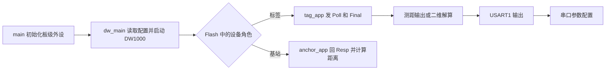

# UWBCE 项目梳理

当前工作区包含一套「道尺 UWB」主板应用固件、一份隧道基站通信方案和一套板级原理图。按 Keil 工程及默认入口追踪，固件已经接入 DW1000 标签和基站测距、标签二维解算、串口配置及结果输出。方案里的隧道里程校正、一维定位和 LoRa → 4G 上报仍有实现或联调缺口。本文以 `master` 的 `6c86a5b` 基线和本地资料为依据，结论来自静态核对。

## 系统目标与当前链路

| 场景 | 通信方案 | 当前固件 |
| --- | --- | --- |
| 隧道里程校正 | 固定里程点的基站检测振动后广播线名、行别和里程。车载或便携标签根据测距趋势判断经过校正点。 | 标签与基站已有测距状态机。默认主循环中未找到完整的唤醒、线路信息广播和里程校正流程。 |
| 隧道一维定位 | 以隧道轴向为坐标轴，利用已知间距的基站和标签测距计算纵向位置。 | `$setmode 1` 能设置 1D 枚举。`dw_CalcDistanceOrCoordinates()` 只处理模式 0 和 2，模式 1 当前不会产生定位输出。 |
| 隧道二维定位 | 至少三座基站提供距离，标签解算平面坐标，并按方案经最近的从站、LoRa 主站、4G 回传。 | 标签能把至少三条有效距离用于高度投影、线性最小二乘和高斯–牛顿精化，再输出 ENU 坐标和换算后的经纬度。结果从 USART1 输出，主从站回传链路尚未接入默认主循环。 |

方案中的 **±10～30 cm** 是设计目标。当前工作区没有可据以确认精度、覆盖距离或并发容量的实测报告。

## 固件入口与代码地图

| 位置 | 作用 |
| --- | --- |
| [`project/AccessControl.uvprojx`](project/AccessControl.uvprojx) | 唯一 Keil 目标 `AccessControl`。器件 STM32L431RCTx，ARMCC 5.06 update 6，设备包 `Keil.STM32L4xx_DFP.2.0.0`。以该文件的源文件清单判断哪些代码参与构建。 |
| [`app/source/main.c`](app/source/main.c) | 设置中断向量表，初始化系统时钟、串口、Flash、EEPROM、语音、IMU、DW1000 等。`USE_DWMAIN=1` 进入 `dw_main()`。4G 连接、周期上报及原有业务处理在 `!USE_DWMAIN` 主循环分支中。 |
| [`app/dw_app/`](app/dw_app/) | `dw_main.c` 负责 DW1000 配置、角色选择、Flash 参数、定位解算和串口输出。`instance_tag.c` 与 `instance_anchor.c` 分别实现标签和基站状态机，`instance.h` 定义当前空口帧和时序。 |
| [`app/decadriver/`](app/decadriver/) · [`app/platform/`](app/platform/) · [`bsp/`](bsp/) | Decawave DW1000 驱动 04.00.05、SPI 和中断适配、板级外设。UWB IRQ 进入 `EXTI15_10_IRQHandler()`，再由 `dwt_isr()` 分发收发、超时和错误回调。 |
| [`app/source/app_cmd.c`](app/source/app_cmd.c) · [`app/source/app_glovar.c`](app/source/app_glovar.c) | 串口命令、参数及基站坐标持久化。W25Q 外置 Flash 上的 UWB 坐标区从 `0x00040000` 开始，设备参数区从 `0x00040200` 开始，读写带 CRC16。24C02 EEPROM 用于设备编号和硬件版本。 |
| [`app/transGPS_app/`](app/transGPS_app/) · [`app/madgwick_app/`](app/madgwick_app/) | 经纬度与本地 ENU 坐标转换、IMU/UWB 融合模块。当前二维输出使用以 0 号基站为参考的 ENU 换算。融合模块有初始化，`uwb_imu_update()` 尚未接入默认测距循环。 |
| [`app/source/`](app/source/) 下的 `uwb_*.c` | 另有 `Ranging_*`、`Anchor_*`、Beacon/TDMA 和 UWB 分包传输实现。文件列在 Keil 工程中，默认主循环走 `app/dw_app/` 的状态机。 |
| [`update/`](update/) · [`app/source/iap.c`](app/source/iap.c) | 应用侧升级流程，包含暂存、差分恢复和跳转接口。当前目标选用 `update/Update.c`、`Dump.c`，以及 `app/source/` 下的 `iap.c`、`vFile.c`、`IAP_bsdiff.c`。 |
| [`Libraries/`](Libraries/) | STM32L4 HAL、CMSIS 和 STM32 Cryptographic 库，以及 MCU 启动代码。 |

### 实际测距与调试

- 标签广播 Poll，各基站按 ID 延时发送 Resp，标签汇总接收时间戳后发 Final。基站收到 Final 后用 DS-TWR 计算飞行时间，做距离偏差补偿，并将本轮距离存为毫米值，随下一轮 Resp 回传。A0 通过 Resp 附带标签时隙修正量。
- 当前空口配置为 CH2、6.8 Mbit/s、PRF 64 MHz、4 个基站、5 个标签时隙，每槽 10 ms。Poll、Resp、Final 的功能码分别为 `0x21`、`0x10`、`0x23`，长度分别为 26、19、40 字节，发送时另加 2 字节 FCS。默认 PAN ID 为 `0xDECA`，默认天线延迟参数为 `16500`，需结合标定结果使用。
- 工程定义了 `UWB_DEVICE_TYPE=UWB_DEVICE_TAG`。默认状态机由启动时读出的 `g_DevConfig.DeviceMode` 选择，参数读取失败时回退到标签、ID 0、测距模式。串口可以修改角色和 ID，保存并重启后由 `set_instance()` 按配置重新注册回调和设置短地址。
- 上电默认 `SWITCHTYPE=2` 时，USART1 走 USB 调试路径，使用 115200 8N1。检测到专用工具时可能切换到 `SWITCHTYPE=1` 和 345600、9 位字长。命令以 `$` 开头、参数用空格分隔、以 CRLF 结尾。先用 `$info` 和 `$setconfig` 读配置。基站可用 `$setconfig mode anchor`、`$setconfig id <0～3>`、`$setconfig save` 后重启。标签从 0 号基站开始用 `$setcoord <编号> <经度> <纬度>` 配坐标，随后用 `$savecoord` 保存。`$setmode 0` 输出距离，`$setmode 2` 解算二维位置。命令以 [`app_cmd.h`](app/include/app_cmd.h) 中的注册表为准。

## 板级硬件与接口

按 [原理图](相关资料/SCH_GJCDW_V1.3_2026-11-18.pdf) 第 4～8 页的详细网名对照 BSP。第 2 页总框图对 SPI、I²C、蓝牙和 IMU 的标注有差异。原理图标题为 `GJCDW_V1.3`，部分图框另标 `GJCDW_V1.4_20261013`，交接时应以实物板号和对应出图版本核定。

| 硬件 | 详细图页与固件接口 |
| --- | --- |
| MCU | STM32L431RCT6，第 5 页。8 MHz 外部晶振，固件 PLL 配置对应 72 MHz。H2 引出 SWD。 |
| DW1000 UWB | 第 5、8 页。SPI2 `PB10=SCK`、`PC2=MISO`、`PC3=MOSI`、`PB2=CS`。`PB11=RST`、`PB14=IRQ`、`PA8=EN_UWB_PWR`。射频链路含 ZD4337 前端和天线，由 DW1000 的 `EXTPA`、`EXTRXE` 控制收发。 |
| W25Q32JVUUIQ | 第 5 页。SPI1 `PA5/PA6/PA7=SCK/MISO/MOSI`、`PA4=CS`。保存参数、坐标与升级数据。 |
| 24C02 EEPROM 与 LSM6DSO IMU | 第 5、6 页。I²C1 `PB8=SCL`、`PB9=SDA`。IMU 为 `LSM6DSOWTR`，驱动文件沿用 `lsm6dsl_reg` 命名，设备 ID 校验值已设为 `0x6C`。 |
| RTK / GNSS | 第 5、6 页。详细图器件标注 `LC29H`，USART2 `PA2/PA3=TX/RX`，`PB13` 控制 RTK 电源。 |
| 4G | 第 5、7 页。ML307C、贴片 SIM 与 LTE 天线。USART3 `PC4/PC5=TX/RX`，`PA15` 控制供电、`PB12` 控制复位。当前工程包含 4G 驱动和业务源码，默认主循环无定位数据上传流程。 |
| 调试 / 蓝牙 / 语音 | 第 4～6 页。USART1 `PB6/PB7=TX/RX` 经 `PA12` 控制的开关切换 USB 或蓝牙。USB 转串口为 CH340E，蓝牙详细图标注 `doBT-M01L`，另有 MAX3485 工具接口和 WT588E02B 语音。 |
| 供电与电量 | 第 1、3、4 页。板上使用 3.7 V 锂电池和 USB 充电电路，MCU/外设、RTK、UWB 有各自供电分支，另有 DW1000 1.8 V、4G 约 4.2 V 支路及软关机电路。修改记录写明移除 CW2015 和振动马达，当前 `main()` 在非充电启动时仍两次调用 `CW2015Init()`，同时保留 ADC 电量采样。 |

## 设计与实现的差异

| 核对项 | 观察结果 |
| --- | --- |
| 无线协议 | Word V1.0 设计为 48 字节固定帧、1 秒 Beacon 周期、50 个 15 ms 时隙。`uwb_protocol_spec.h` / `uwb_tdma.h` 的另一套设计使用 50 个 12 ms 时隙和 600 ms 周期。现用帧与时隙以 `app/dw_app/instance.h` 为准，对接设备需要同一套空口定义。 |
| 无线标称能力 | 方案引用了 802.15.4z/STS，配套数据手册把 DW1000 标为 IEEE 802.15.4-2011 UWB。当前源码未找到 STS 配置或处理链路。 |
| 硬件选型 | 方案的 L471、ADXL362、W25Q128、UM980 与提供的主板详细图所用器件不同。方案选用外接 E22-400M30S，主板详细图未见该模块。仓库中的 `app_lora.c`、`LORA_Comm.c` 和 `ebyte_*.c` 未列入当前 Keil 目标。 |
| 引脚复用 | `InitUart()` 还会为 LPUART1 初始化 `PB10/PB11`，后续 UWB 初始化将这两个引脚用于 SPI2 SCK 和 DW1000 复位。当前板级接口表按后续 UWB 配置填写。 |
| 配置与射频 | `g_DevConfig` 有 `DwConfig` 字段，启动时实际射频配置来自 `dwt_configure(&config1)`。默认分支把 `config2` 存入配置结构，显示的参数可能与实际射频配置不同。 |
| 启动地址 | `main()` 将 VTOR 设为 `0x08010000`，IAP 头文件约定前 64 KiB 给 Bootloader、后 192 KiB 给应用。工程片上链接区也配置了 `0x08010000/0x30000`。本地未见独立 Bootloader 工程、发布镜像或链接映射输出。 |

## 资料索引

| 资料 | 用途 |
| --- | --- |
| [隧道 UWB 定位基站通信流程方案 V1.0](相关资料/260727_隧道UWB定位基站通信流程方案.docx) | 第 1～3 章介绍三种使用场景、器件选型和部署几何，第 4 章给出拟定的测距帧和时序。 |
| [GJCDW 原理图](相关资料/SCH_GJCDW_V1.3_2026-11-18.pdf) | 8 页，依次为修改记录、框图、电源树、电源/USB、MCU/存储、外设、4G、UWB。排查接口时结合第 4～8 页详细网名。 |
| [DW1000 数据手册 V2.2](<相关资料/UWBT_QORVO(威讯)_V2.2_DW1000_en.pdf>) | 查引脚、电源、SPI、射频、PHY 和芯片能力。 |
| [DW1000 用户手册 V2.18](<相关资料/UMAN_QORVO(威讯)_V2.18_DW1000用户手册_en.pdf>) | 查寄存器映射、收发时间戳、延时发送、校准和驱动调试。 |
| [Qorvo APS014 天线延迟校准 V1.3](<相关资料/NOTE_QORVO(威迅)_APS014 基于DW1000产品和系统的天线延迟校准_en.pdf>) | 查参考设备建立和 TWR 标定方法。基站与标签都涉及天线延迟，标定结果对应 `$setconfig antdly <数值>`。 |

当前 `.gitignore` 包含 `相关资料/`，上面 5 份文件只在本地工作区。交接材料还缺可编辑 PCB/原理图源工程、BOM、Bootloader 或发布镜像、板级测试记录和隧道部署实测记录。

## 构建与联调核对顺序

1. 用 Keil 打开 `project/AccessControl.uvprojx`，确认 ARMCC 5 和 STM32L4 设备包。核对构建输出的向量地址和 Flash 下载设置。工程启用 HEX 输出到 `project/Objects/`。此次已核对工程文件清单中的路径，未实际编译或烧录。
2. 确认实物板号、应用启动链路和调试串口。先看 MCU 启动、W25Q/EEPROM、IMU ID 与 DW1000 的设备 ID `0xDECA0130`，再确认中断、Poll/Resp/Final 及第二轮起的距离回传。
3. 用单标签和单基站做已知距离对照并记录天线延迟与误差，再用至少三座有效基站验证坐标、安装高度和二维输出。空口吞吐、隧道非视距表现和 LoRa/4G 上报应分别用现场结果确认。
